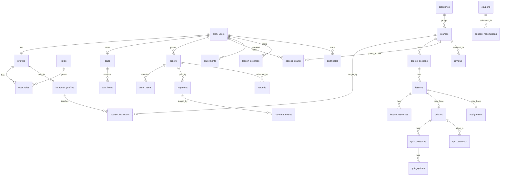

# Cơ sở dữ liệu

PostgreSQL (Supabase). Khoá chính UUID; tiền tệ **BIGINT VND** (không dùng số thực). Mọi bảng bật RLS.
Migration: `supabase/migrations/2026112100000{1..6}_*.sql`. Kiểm thử: `npm run test:db`.

## ERD (rút gọn)

## Nhóm bảng

| Nhóm | Bảng | Ghi chú |
| --- | --- | --- |
| Định danh | `profiles`, `roles`, `user_roles`, `instructor_profiles`, `user_preferences` | Không có cột role trong `profiles`. Trigger `handle_new_user` tạo profile + vai trò `student`. |
| Danh mục | `categories`, `courses`, `course_instructors`, `course_sections`, `lessons`, `lesson_resources`, `course_tags`, `course_prerequisites` | `courses.status`: draft → in_review → published → archived. View `course_cards` cho trang danh sách. |
| Thương mại | `carts`, `cart_items`, `coupons`, `coupon_courses`, `orders`, `order_items`, `payments`, `payment_events`, `coupon_redemptions`, `refunds` | CHECK `total = subtotal - discount`; snapshot giá trong `order_items`; `payment_events(provider,event_id)` unique. |
| Học tập | `access_grants`, `enrollments`, `lesson_progress`, `lesson_notes`, `quizzes`, `quiz_questions`, `quiz_options`, `quiz_attempts`, `quiz_answers`, `assignments`, `assignment_submissions`, `certificates` | `access_grants` là nguồn quyền truy cập duy nhất. `enrollments(user,course)` unique. |
| Cộng đồng | `reviews`, `wishlists`, `discussion_threads`, `discussion_messages`, `notifications`, `support_tickets`, `support_messages`, `newsletter_subscribers` | |
| Quản trị | `audit_logs` (chỉ thêm), `announcements`, `email_templates`, `email_outbox`, `system_settings`, `activity_events`, `banners` | |

## Hàm quan trọng (SECURITY DEFINER)

| Hàm | Mục đích |
| --- | --- |
| `has_role(code)`, `is_admin()`, `is_staff()` | Dùng trong RLS |
| `is_course_instructor(course)` | Giảng viên chỉ sửa khoá được phân công |
| `has_course_access(user, course)` | Grant còn hiệu lực, chưa hết hạn, chưa thu hồi |
| `can_view_lesson(lesson)` | Bài học thử của khoá đã xuất bản, hoặc có quyền truy cập |
| `get_lesson_content(lesson)` | Trả nội dung/ID video chỉ khi `can_view_lesson` |
| `verify_certificate(code)` | Xác thực chứng chỉ công khai, không lộ bảng |
| `assign_role(user, role, grant)` | Chỉ super_admin; ghi `audit_logs` |
| `vn_unaccent(text)` | Bỏ dấu tiếng Việt cho tìm kiếm |

## Ẩn cột nhạy cảm

- `lessons.content`, `lessons.bunny_video_id`: thu hồi quyền SELECT cột với `anon/authenticated`.
- `quiz_options.is_correct`: thu hồi quyền SELECT cột; chấm điểm chạy phía server.
- `instructor_profiles.status/slug`: giảng viên không tự sửa được.

## Kiểm thử chính sách (19 ca, đều đạt)

Khách thấy catalog nhưng không đọc được nội dung bài trả phí; học viên không đọc đơn hàng/quyền của người khác; không tự cấp quyền/role; không đọc đáp án; giảng viên không sửa khoá không được phân công; grant/enrollment trùng bị chặn; thu hồi quyền chặn nội dung; tổng tiền đơn phải khớp; audit log không sửa được.
